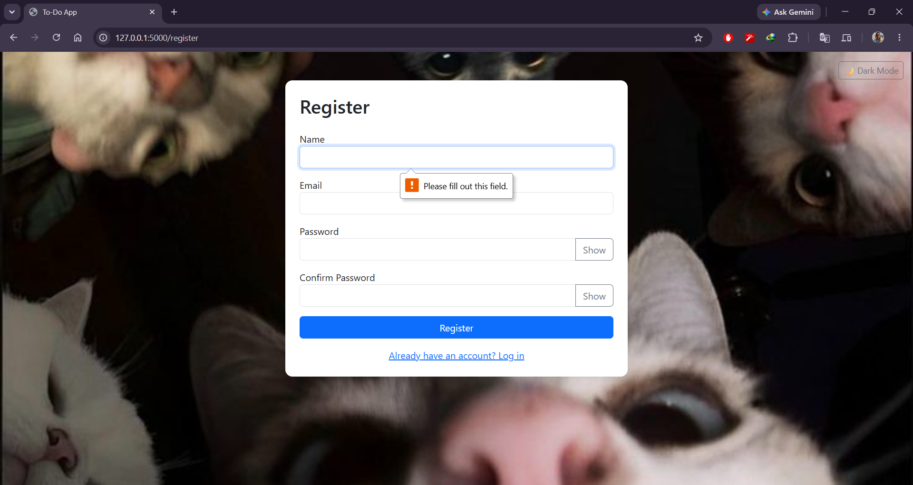
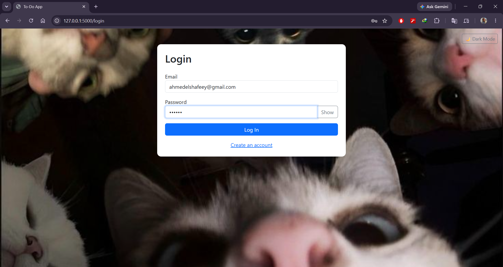
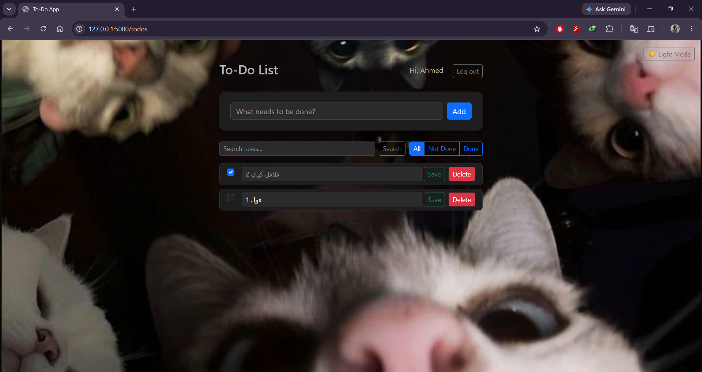
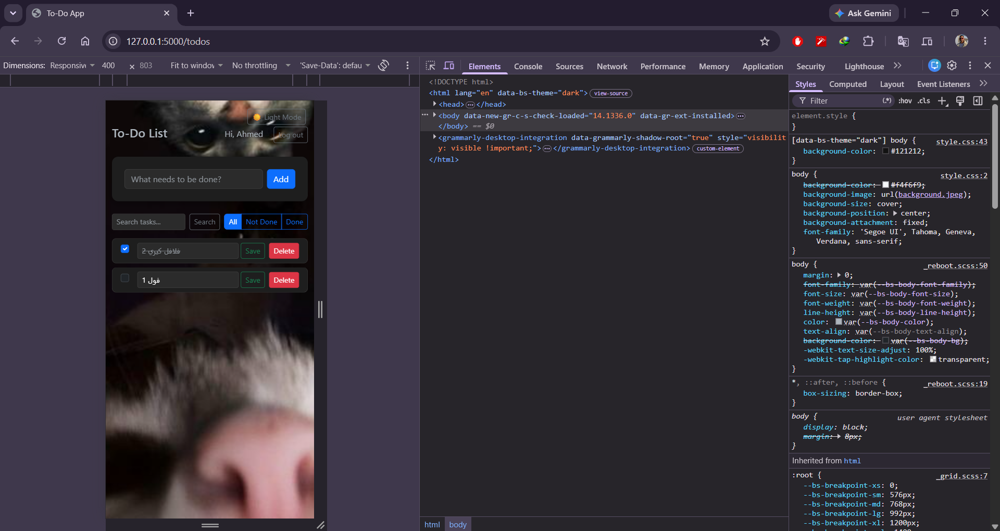

# Lab 2: Login & To-Do Application

## 1. Team Members
* Ahmed Mohamed Elshafeey (ID: 2304088)
* Essa Ali Essa (ID: 2304057)

## 2. Technologies Used
* **Backend:** Python (Flask)
* **Frontend:** HTML, Bootstrap (CSS framework), Jinja2 Templates
* **Database:** MySQL (using PyMySQL)
* **Security:** bcrypt (for password hashing)

## 3. How to Run
1. Install requirements: `pip install flask flask-bcrypt pymysql python-dotenv`
2. Set up the database: Run `mysql -u root -p < database/schema.sql`
3. Rename `.env.example` to `.env` and fill in your local database credentials.
4. Start the server: `python app.py`
5. Open your browser and navigate to `http://127.0.0.1:5000/`

## 4. Features Built
* Registration and login with bcrypt password hashing (R1, R2, R9).
* Private to-do list secured by user session (R3).
* Add, Edit, Mark Done, and Delete functionality (R4, R5, R6, R7).
* Server-side and browser-side validation (R8).
* Responsive UI with consistent styling and feedback messages (R10).
* **BONUS:** Fully functional Dark Mode utilizing Bootstrap 5.3 `data-bs-theme` and JavaScript `localStorage`.
* **BONUS:** List filters (All / Open / Done) and a search box that dynamically updates the SQL query using `LIKE` and `is_done` conditional statements.

## 5. Screenshots

**Register Error:**

**Login Page:**

**To-Do List:**

**Mobile View:**

## 6. Theory Questions

**(a) Why do UPDATE and DELETE contain `AND user_id = ?`, and what changes if you remove it?**  
The AND user_id = ? condition ensures that users can only modify or delete their own tasks. Because the todo_id comes from the browser, a user could manipulate the request to send someone else's task number. Adding the logged-in user's ID to the query means it will change zero rows if the task does not belong to them. If you remove it, any user could update or delete any task in the entire database.

**(b) What happens if you insert a to-do for a `user_id` that does not exist, and which constraint of the lecture is that?**  
The database will reject the query and return an error because every to-do must belong to exactly one user. This enforces the foreign key constraint (specifically, referential integrity), meaning the todos table can only point to a user_id that already exists in the users table.

**(c) Why do you store a hash and not the password?**  
Storing a hash ensures that if the database is exposed, the actual passwords remain hidden. Using a salted hash like bcrypt means that even if two users have the same password, their hashes will look completely different, and its intentional slowness prevents attackers from quickly guessing passwords.

**(d) The `name` column is NOT NULL: why did you still need your own check for an empty name?**  
The database considers an empty string ('') to be a valid text value, not a missing value. Therefore, NOT NULL will accept an empty string, meaning you must write your own server checks to refuse empty names before they reach the database.